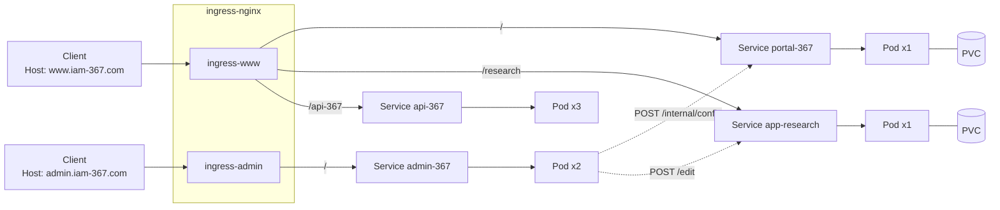

# K8s Ingress Exam (iam-367)

บริการ 4 ตัวบน Kubernetes 3 node เข้าถึงผ่าน ingress-nginx ด้วย domain `iam-367.com` (รหัสนักศึกษา 68130367)

| URL | หน้าที่ | Deployment | จำนวน Pod |
|---|---|---|---|
| `www.iam-367.com/` | แสดงรูป ชื่อ และ id ของนักศึกษา | `portal-367` | 1 (ข้อมูลเก็บใน PVC) |
| `www.iam-367.com/research` | แสดงสรุปงานวิจัย | `app-research` | 1 (ข้อมูลเก็บใน PVC) |
| `www.iam-367.com/api-367/<ข้อความ>` | แสดงข้อความตัวใหญ่กลางจอ | `api-367` | 3 |
| `admin.iam-367.com` | หน้าปุ่มเลือกแก้ไขข้อมูลของ portal และ research | `admin-367` | 2 |



หน้า admin ส่งข้อมูลที่แก้ไปให้ `portal-367` และ `app-research` ผ่าน Service ภายใน cluster (ไม่ผ่าน ingress) แต่ละตัวเขียนลง PVC ของตัวเอง ส่วนเส้นทาง `/internal/*` ของสองตัวนี้ตอบ 403 เมื่อเรียกมาจาก ingress

## สรุปสั้น

ถ้ามี cluster 3 node ที่มี ingress-nginx อยู่แล้ว ใช้คำสั่งชุดนี้ก็ deploy และทดสอบเสร็จ คำสั่งในชุดนี้ไม่ต้องใช้ bash และไม่ขึ้นกับระบบปฏิบัติการ (macOS, Linux, Windows PowerShell หรือ CMD)

```bash
git clone https://github.com/68130367/k8s-ingress-exam.git
cd k8s-ingress-exam
kubectl get nodes
kubectl get ingressclass nginx
kubectl apply -k .
kubectl logs -f job/ingress-check --pod-running-timeout=180s
```

ถ้าไม่มี git ให้กด Code → Download ZIP ที่หน้า repo แล้วแตกไฟล์ จากนั้นรันคำสั่งตั้งแต่ `kubectl get nodes` ในโฟลเดอร์ที่แตกออกมา คำสั่งที่สองต้องเห็น 3 node สถานะ `Ready` คำสั่งที่สามต้องขึ้นแถว `nginx` ถ้าไม่ขึ้นให้ทำ [ข้อ 1](#1-ติดตั้ง-ingress-nginx) ก่อน คำสั่งสุดท้ายแสดงผลทดสอบ 12 ข้อ ผลที่ถูกต้องคือบรรทัดสุดท้ายเป็น `---- pass=12 fail=0` (บรรทัด `waiting to start: ContainerCreating` ที่ขึ้นก่อนเป็นเรื่องปกติ แค่รอ container เริ่มต้น)

## สิ่งที่ต้องมี

- cluster Kubernetes **3 node** ที่ `kubectl` ต่อได้ เช่น minikube (`--nodes 3`), kubeadm บน VM หรือเครื่องจริง ตรวจด้วย `kubectl get nodes` ต้องเห็น 3 แถวสถานะ `Ready`
- `kubectl` รุ่น 1.21 ขึ้นไป (มี kustomize v4 ในตัว รุ่นเก่ากว่านี้อาจอ่าน `kustomization.yaml` ของ repo นี้ไม่ได้) ส่วน script `*.sh` และ `curl` เป็นทางลัดทางเลือกที่ต้องใช้ bash (macOS และ Linux มีอยู่แล้ว ส่วน Windows ให้รันใน Git Bash หรือ WSL)
- **ทุก node ต้องออกอินเทอร์เน็ตเพื่อดึง image `python:3.12-alpine` ได้** (ไม่ต้อง build หรือ push image เอง ส่วนโค้ดของแต่ละ app เป็นไฟล์ `app.py` ไฟล์เดียวที่ใช้แค่ stdlib และ `kubectl apply -k .` จะสร้าง ConfigMap จากไฟล์ใน repo ตาม `kustomization.yaml` แล้ว mount เข้า pod ให้)
- deploy ใน namespace `default` (PV ที่ให้มาผูกกับ namespace นี้) ถ้า cluster เป็น kubeadm ที่ node แบบ control-plane มี taint ไม่รับ pod ทั่วไป pod จะลงที่ worker เท่านั้น ซึ่งเป็นเรื่องปกติ
- ไม่ต้องมี StorageClass เพราะ `kustomization.yaml` สร้าง PV แบบ hostPath (`manifests/storage-hostpath.yaml`) ให้ PVC ของ `portal-367` และ `app-research` ใช้ ข้อมูลที่แก้ผ่านหน้า admin จึงอยู่ในโฟลเดอร์ `/data/portal-367` และ `/data/app-research` บน node ที่ pod รันอยู่
- ไม่ต้องแก้อะไรก่อนรัน ชื่อและรหัสนักศึกษาอยู่ใน `config.env` โดเมนอยู่ใน `manifests/40-ingress.yaml` รูปอยู่ที่ `portal-367/photo.jpg` และสรุปงานวิจัยตั้งต้นอยู่ที่ `app-research/research.seed.md`

## วิธี run

คำสั่งในทุกบล็อกใช้ได้เหมือนกันใน bash, zsh, PowerShell และ CMD ยกเว้นที่ระบุไว้

### 1. ติดตั้ง ingress-nginx

ข้ามข้อนี้ได้ถ้า `kubectl get ingressclass nginx` ขึ้นแถว `nginx` อยู่แล้ว

**ถ้าใช้ minikube** (ถ้ายังไม่มี cluster 3 node ให้สร้างด้วยคำสั่งแรก)

```bash
minikube start --nodes 3 --cpus 2 --memory 2048
minikube addons enable ingress
kubectl wait -n ingress-nginx --for=condition=ready pod -l app.kubernetes.io/component=controller --timeout=240s
```

**ถ้าใช้ kubeadm, VM, Docker Desktop Kubernetes หรือ cluster อื่น**

```bash
kubectl apply -f https://raw.githubusercontent.com/kubernetes/ingress-nginx/controller-v1.12.1/deploy/static/provider/baremetal/deploy.yaml
kubectl wait -n ingress-nginx --for=condition=ready pod -l app.kubernetes.io/component=controller --timeout=240s
```

manifest นี้เป็นเวอร์ชันเดียวกับที่ใช้ในงาน #3 ถ้าลิงก์ใช้ไม่ได้ ให้ดูวิธีติดตั้งล่าสุดที่ https://kubernetes.github.io/ingress-nginx/deploy/ (เลือกแบบ bare-metal) แล้วตรวจว่า `kubectl get ingressclass nginx` มีแถว `nginx`

### 2. Deploy และทดสอบ

```bash
kubectl apply -k .
kubectl logs -f job/ingress-check --pod-running-timeout=180s
```

คำสั่งแรกอ่าน `kustomization.yaml` แล้วสร้างทุกอย่างในครั้งเดียว คือ PV, ConfigMap, PVC, Deployment, Service, Ingress และ Job ทดสอบ ส่วนคำสั่งที่สองดูผลของ Job ซึ่งรันใน cluster เอง รอจน app พร้อมแล้วยิง request ผ่านชื่อ Service ของ ingress-nginx ภายใน cluster จึงไม่ต้องรู้ IP ไม่ต้องตั้ง `port-forward` และไม่ต้องแก้ไฟล์ hosts

ผลที่ถูกต้องคือขึ้น `PASS` ครบ 12 ข้อ และบรรทัดสุดท้ายเป็น `---- pass=12 fail=0` ถ้ามีข้อที่ `FAIL` ให้ดูข้อที่ล้มในผลนั้น คำสั่งรันซ้ำได้โดยไม่ต้องลบของเดิม แต่ Job รันแค่ครั้งเดียวต่อการสร้าง ถ้าจะทดสอบซ้ำให้ลบ Job แล้วสร้างใหม่

```bash
kubectl delete job ingress-check
kubectl apply -k .
kubectl logs -f job/ingress-check --pod-running-timeout=180s
```

ตรวจว่า pod กระจายอยู่หลาย node (ดูคอลัมน์ NODE)

```bash
kubectl get pods -o wide
```

ถ้า Service ของ ingress-nginx ไม่ได้ชื่อ `ingress-nginx-controller` ใน namespace `ingress-nginx` (เช่น ติดตั้งด้วย Helm ที่ตั้งชื่อเอง) ให้เพิ่ม env `INGRESS_HOST` ชื่อ Service เต็ม ลงใน `manifests/50-check-job.yaml` ตรงส่วน `env`

ถ้าใช้ bash จะใช้ทางลัด `./deploy.sh` แทนก็ได้ script นี้ตรวจว่ามี ingress-nginx แล้วรัน `kubectl apply -k .` และรอ pod พร้อม

### 3. เปิดดูในเบราว์เซอร์ (ไม่บังคับ)

ingress เลือก app จากชื่อโดเมนที่เบราว์เซอร์ส่งมา เปิด `localhost` หรือ IP ตรง ๆ จะได้ 404 จึงต้องให้เครื่องรู้ว่า `www.iam-367.com` และ `admin.iam-367.com` คือเครื่องนี้ วิธีนี้ใช้ได้กับทุก cluster และทุกระบบ (ถ้าเข้า ingress ด้วยวิธีอื่นที่ไม่ใช่ port-forward ดู[หัวข้อทางเลือกอื่น](#ทางเลือกอื่น))

**เลือกวิธีเข้า ingress ตามที่เปิดเบราว์เซอร์**

- เบราว์เซอร์อยู่บนเครื่องเดียวกับที่รัน `kubectl` และ cluster เป็น minikube หรือ Docker Desktop ให้ใช้ `port-forward` ตามขั้นตอนด้านล่าง
- **cluster เป็น VM หรือเครื่องจริง (เช่น kubeadm 3 VM) และเปิดเบราว์เซอร์จากเครื่องอื่น (เช่น Windows ที่ต่อกับ VM) ให้ข้ามไปใช้ [วิธีสำหรับ VM](#วิธีสำหรับ-vm-หรือเครื่องจริง-kubeadm) ท้ายข้อนี้** เพราะ `port-forward` เปิดที่ `localhost` ของเครื่องที่รัน `kubectl` เท่านั้น เครื่องอื่นเข้าไม่ถึง

1. เปิดเทอร์มินัลหนึ่งรันคำสั่งนี้ค้างไว้ (ถ้าพอร์ต 8080 ถูกใช้อยู่ ให้เปลี่ยนเลขตัวแรก เช่น `8081:80` แล้วใช้เลขนั้นใน URL)
   ```bash
   kubectl -n ingress-nginx port-forward svc/ingress-nginx-controller 8080:80
   ```
2. เพิ่มบรรทัด `127.0.0.1 www.iam-367.com admin.iam-367.com` ลงในไฟล์ hosts ของระบบที่ใช้เปิดเบราว์เซอร์ ต้องใช้สิทธิ์ admin

   **macOS และ Linux** ไฟล์คือ `/etc/hosts`
   ```bash
   echo "127.0.0.1 www.iam-367.com admin.iam-367.com" | sudo tee -a /etc/hosts
   ```
   **Windows** ไฟล์คือ `C:\Windows\System32\drivers\etc\hosts` เปิด PowerShell แบบ Run as administrator แล้วรัน
   ```powershell
   Add-Content -Path "C:\Windows\System32\drivers\etc\hosts" -Value "`n127.0.0.1 www.iam-367.com admin.iam-367.com"
   ```
   ถ้าเปิดเบราว์เซอร์บน Windows ต้องแก้ไฟล์ hosts ของ Windows ข้างบน การแก้ `/etc/hosts` ใน WSL หรือ Git Bash ไม่มีผลกับเบราว์เซอร์
3. เปิด URL เหล่านี้
   - `http://www.iam-367.com:8080/`
   - `http://www.iam-367.com:8080/research`
   - `http://www.iam-367.com:8080/api-367/สวัสดี`
   - `http://admin.iam-367.com:8080/`
4. ลองแก้ข้อมูล: ที่หน้า admin กด "แก้ portal" หรือ "แก้ research" แล้วบันทึก จากนั้นเปิดหน้า `www.iam-367.com/` และ `/research` จะเห็นข้อมูลที่เปลี่ยน

เมื่อดูเสร็จให้กด `Ctrl+C` ที่เทอร์มินัล `port-forward` และลบบรรทัดที่เพิ่มออกจากไฟล์ hosts ด้วย editor ที่เปิดด้วยสิทธิ์ admin

#### วิธีสำหรับ VM หรือเครื่องจริง (kubeadm)

ใช้เมื่อ cluster เป็น VM หลายเครื่องที่ join กัน และเปิดเบราว์เซอร์จากเครื่องที่ต่อ VM ได้ (เช่น Windows host หรือ Ubuntu) ingress-nginx แบบ bare-metal (ข้อ 1) เปิดพอร์ตที่ทุก node เป็น NodePort จึงเข้าด้วย IP ของ node ใดก็ได้ ไม่ต้องใช้ `port-forward`

1. ล็อก NodePort ของ http ไว้ที่ 31080 (ถ้าไม่ล็อก ระบบจะสุ่มเลขพอร์ตให้ ดูได้จาก `kubectl get svc -n ingress-nginx` แล้วใช้เลขนั้นแทน 31080 ด้านล่าง)
   ```bash
   kubectl -n ingress-nginx patch svc ingress-nginx-controller -p '{"spec":{"ports":[{"port":80,"nodePort":31080}]}}'
   kubectl get svc -n ingress-nginx ingress-nginx-controller
   ```
   ต้องเห็น `80:31080/TCP` ในคอลัมน์ PORT(S)
2. หา IP ของ node ด้วย `kubectl get nodes -o wide` ดูคอลัมน์ INTERNAL-IP ใช้ node ไหนก็ได้ แต่ต้องเป็น IP ที่เครื่องซึ่งเปิดเบราว์เซอร์เข้าถึงได้ (VM แบบ bridged หรือ host-only ที่ ping ถึง) และถ้า VM เปิด firewall ไว้ ให้เปิดพอร์ต 31080/TCP
3. บนเครื่องที่เปิดเบราว์เซอร์ เพิ่มบรรทัด `<IP ของ node> www.iam-367.com admin.iam-367.com` ในไฟล์ hosts (วิธีแก้ไฟล์ของแต่ละระบบดูขั้นตอนที่ 2 ด้านบน แต่ใช้ IP ของ node แทน `127.0.0.1`)
4. เปิด URL โดยใส่ `:31080` ต่อท้าย
   - `http://www.iam-367.com:31080/`
   - `http://www.iam-367.com:31080/research`
   - `http://www.iam-367.com:31080/api-367/สวัสดี`
   - `http://admin.iam-367.com:31080/`

ถ้ามี nginx เป็น load balancer แยกอยู่หน้า cluster ให้ใช้ [หัวข้อ external load balancer](#กรณีมี-external-load-balancer-nginx-บน-vm-แยก) แทน

### เลิกใช้

```bash
kubectl delete -k .
```

คำสั่งนี้ลบเฉพาะ resource ของ exam นี้ (รวม Job ทดสอบและ PV) ไม่ลบ ingress-nginx ถ้าใช้ bash จะใช้ `./teardown.sh` แทนก็ได้

โฟลเดอร์ข้อมูล `/data/portal-367` และ `/data/app-research` บน node ไม่ถูกลบอัตโนมัติ ถ้าต้องการให้ deploy ครั้งต่อไปเริ่มจากค่าตั้งต้น (`config.env` และ `research.seed.md`) ให้ ssh เข้า node ที่ pod รันอยู่แล้วลบสองโฟลเดอร์นี้

ถ้าแก้โค้ด app แล้วอยากให้ pod ใช้โค้ดใหม่ ให้รัน `kubectl apply -k .` ตามด้วยคำสั่งนี้ (ใน bash ใช้ `./deploy.sh --restart` แทนได้)

```bash
kubectl rollout restart deployment -l app.kubernetes.io/part-of=k8s-ingress-exam
```

## ทางเลือกอื่น

### เข้า ingress โดยไม่ใช้ port-forward

ถ้า cluster เปิดทางเข้า ingress ให้เครื่องของคุณอยู่แล้ว จะใช้ IP และพอร์ตนั้นแทน `127.0.0.1:8080` ก็ได้ ใช้ได้ทั้งตอนตั้งไฟล์ hosts (เปลี่ยน `127.0.0.1` เป็น IP นั้น) และตอนทดสอบจากภายนอกด้วย bash

- `INGRESS_IP` คือ IP ของเครื่องที่รับ request เข้า ingress-nginx เมื่อมองจากเครื่องที่คุณพิมพ์คำสั่ง
- `INGRESS_PORT` คือพอร์ตของเครื่องนั้น

เลือกแถวที่ตรงกับ cluster ของคุณ

| cluster ของคุณ | INGRESS_IP | INGRESS_PORT |
|---|---|---|
| Docker Desktop Kubernetes (ล็อก NodePort ตามหัวข้อ load balancer ด้านล่างแล้ว) | `127.0.0.1` | `31080` |
| minikube ที่เข้า IP ของ node ได้ | ผลของ `minikube ip` | เลขหลัง `80:` ในคอลัมน์ PORT(S) ของ `kubectl get svc -n ingress-nginx ingress-nginx-controller` เช่น `80:31080/TCP` คือ `31080` |
| kubeadm, VM หรือเครื่องจริง | คอลัมน์ INTERNAL-IP ของ `kubectl get nodes -o wide` (node ไหนก็ได้) ใช้ได้เมื่อเครื่องที่รันต่อ IP นั้นถึง | `31080` ถ้าล็อก NodePort ตามหัวข้อ load balancer ด้านล่างแล้ว ไม่เช่นนั้นดูเลขหลัง `80:` ของ Service ด้านบน |
| มี external load balancer | IP ของเครื่อง LB | `80` |
| Service ของ ingress-nginx เป็นชนิด LoadBalancer (เช่น cloud หรือ MetalLB) | คอลัมน์ EXTERNAL-IP ของ `kubectl get svc -n ingress-nginx ingress-nginx-controller` | `80` |

ลองตรวจสองค่านี้ด้วยคำสั่งเดียว ถ้าได้ `200` แปลว่าเข้า ingress ได้ ใน PowerShell บน Windows ให้พิมพ์ `curl.exe` แทน `curl` เพราะ `curl` ในนั้นเป็นชื่อย่อของคำสั่งอื่น

```bash
curl -s -o /dev/null -w "%{http_code}\n" -H "Host: www.iam-367.com" http://<INGRESS_IP>:<INGRESS_PORT>/
```

ถ้าได้ `000` หรือค้างจนหมดเวลา แปลว่าเครื่องที่รันต่อ IP หรือพอร์ตนั้นไม่ถึง ให้ลองแถวอื่นในตาราง เพราะ IP ใน `kubectl get nodes` บางแบบอยู่ในเครือข่ายภายใน เช่น Docker Desktop ที่ได้ `192.168.65.3` ซึ่งเข้าจากเครื่องที่รันไม่ได้ ต้องใช้ `127.0.0.1` แทน

ถ้ามี bash และ `curl` จะรันทดสอบแบบเดียวกับ Job จากเครื่องของคุณได้ โดยใช้ค่าที่หาได้ข้างบน script นี้บันทึกผลไว้ที่ `tests/results.txt`

```bash
INGRESS_IP=<INGRESS_IP> INGRESS_PORT=<INGRESS_PORT> ./tests/check.sh
```

### กรณีมี external load balancer (nginx บน VM แยก)

client เข้า LB ที่พอร์ต 80 แล้ว LB ส่งต่อไปที่ NodePort 31080 ของ worker จากนั้น ingress-nginx ส่งต่อให้ Service และ Pod

ขั้นแรกให้ล็อก NodePort ของ http ไว้ที่ 31080 เพื่อให้ LB ชี้พอร์ตได้ตรงกัน (ทำหลังติดตั้งตามข้อ 1 ถ้าเป็น minikube ให้ตรวจพอร์ตจริงด้วย `kubectl get svc -n ingress-nginx` แล้วใช้เลขนั้นแทน 31080)

```bash
kubectl -n ingress-nginx patch svc ingress-nginx-controller -p '{"spec":{"ports":[{"port":80,"nodePort":31080}]}}'
kubectl get svc -n ingress-nginx
```

คำสั่งหลังต้องเห็น `80:31080/TCP` ในคอลัมน์ PORT(S) จากนั้น deploy ตามข้อ 2 แล้วตั้งค่า LB ดังนี้

1. ส่งไฟล์ [`lb/ingress.conf`](lb/ingress.conf) จากเครื่องที่ clone repo ไปยัง LB (`<user>` คือ user ที่ ssh เข้า LB ได้)
   ```bash
   scp lb/ingress.conf <user>@<IP ของ LB>:/tmp/ingress.conf
   ```
2. ssh เข้า LB แล้วย้ายไฟล์ไปไว้ในโฟลเดอร์ที่ nginx อ่าน
   ```bash
   ssh <user>@<IP ของ LB>
   sudo mv /tmp/ingress.conf /etc/nginx/sites-enabled/ingress.conf
   ```
3. เปิดไฟล์แล้วแก้ IP ของ worker ใน `upstream` ให้เป็นของคุณ (ในไฟล์เป็นค่าตัวอย่าง) ส่วน `server_name` ตั้งเป็น `www.iam-367.com admin.iam-367.com` ไว้แล้ว และพอร์ต 31080 ไม่ต้องแก้ เพราะตรงกับที่ patch NodePort ไว้ข้างบน
   ```bash
   sudo nano /etc/nginx/sites-enabled/ingress.conf
   ```
4. ตรวจ config แล้ว reload nginx ถ้า `nginx -t` แจ้ง error ให้แก้ไฟล์ให้ผ่านก่อน
   ```bash
   sudo nginx -t && sudo systemctl reload nginx
   ```
5. ที่เครื่องซึ่งใช้เปิดเว็บ ให้เพิ่มบรรทัด `<IP ของ LB> www.iam-367.com admin.iam-367.com` ในไฟล์ hosts (วิธีเพิ่มดูที่ข้อ 3 ของหัวข้อ "วิธี run") แล้วเปิด `http://www.iam-367.com/` ได้เลย ไม่ต้องใส่พอร์ตเพราะ LB ฟังพอร์ต 80
6. ทดสอบด้วย `INGRESS_IP=<IP ของ LB> INGRESS_PORT=80 ./tests/check.sh`

ถ้าใช้ `scp` ไม่ได้ ให้รัน `sudo nano /etc/nginx/sites-enabled/ingress.conf` บน LB แล้ววางเนื้อหาของไฟล์ลงไปเองแทนรายการที่ 1 และ 2 ด้านบน

## ตรวจสอบด้วยมือ

```bash
kubectl get nodes -o wide
kubectl get deploy,po,svc,ingress,pvc,pv
kubectl get pods -o wide
kubectl describe ingress ingress-www ingress-admin
kubectl get endpoints portal-367 app-research api-367 admin-367
kubectl logs -n ingress-nginx -l app.kubernetes.io/name=ingress-nginx --tail=20
```

## ปัญหาที่พบบ่อย

| อาการ | สาเหตุและวิธีแก้ |
|---|---|
| `deploy.sh` แจ้งว่ายังไม่มี IngressClass `nginx` หรือ Ingress ไม่มีค่า ADDRESS | ยังไม่ได้ติดตั้ง ingress-nginx ให้ทำข้อ 1 |
| `kubectl get nodes` มีไม่ครบ 3 node | cluster ไม่ตรงโจทย์ ใช้ minikube ให้สร้างด้วย `--nodes 3` (ข้อ 1) หรือเพิ่ม node ด้วย `kubeadm join` |
| pod ค้าง `ImagePullBackOff` หรือ `ErrImagePull` | node ดึง `python:3.12-alpine` ไม่ได้ ตรวจอินเทอร์เน็ตของทุก node ด้วย `kubectl describe pod <ชื่อ pod>` ถ้าข้อความมี `toomanyrequests` แปลว่าติดโควตาดึง image ของ Docker Hub (หลาย node ใช้ IP ออกอินเทอร์เน็ตเดียวกัน) ให้รอสักพักแล้วลองใหม่ หรือดึงล่วงหน้าบนแต่ละ node ด้วย `sudo crictl pull python:3.12-alpine` (ถ้ามี `crictl`) |
| PVC `portal-367-data` หรือ `app-research-data` ค้าง Pending | ปกติไม่ควรเกิด เพราะมี PV hostPath ให้ ตรวจว่ามี `portal-367-pv` และ `app-research-pv` ด้วย `kubectl get pv` และต้อง deploy ใน namespace `default` (PV ผูกกับ namespace นี้) ดูสาเหตุด้วย `kubectl describe pvc <ชื่อ>` |
| บน VM เปิดเว็บจาก Windows หรือเครื่องอื่นไม่ติด | `port-forward` เปิดแค่ที่ `localhost` ของเครื่องที่รัน `kubectl` ให้ใช้ NodePort ตาม[วิธีสำหรับ VM](#วิธีสำหรับ-vm-หรือเครื่องจริง-kubeadm) ตรวจว่า IP ของ node ถึงจากเครื่องที่เปิดเบราว์เซอร์ และ firewall เปิดพอร์ต 31080 |
| Job `ingress-check` ล้ม (`pass` ไม่ครบ 12) | ดูข้อที่ `FAIL` ในผลของ `kubectl logs job/ingress-check` แล้วตรวจ `kubectl get po,ingress` ถ้ามี ingress-nginx ตัวอื่นที่ชื่อ Service ต่างกัน ดูข้อ 2 |
| เปิด URL แล้วได้ 404 จาก nginx | ส่งชื่อโดเมนไม่ตรง ต้องเข้าด้วย `www.iam-367.com` หรือ `admin.iam-367.com` ไม่ใช่ `localhost` หรือ IP |
| `check.sh` ได้ status `000` หรือ connection refused | IP หรือพอร์ตผิด หรือ `port-forward` ไม่ได้เปิดค้างไว้ |
| ข้อมูลที่แก้ผ่านหน้า admin กลับเป็นค่าตั้งต้น | pod ของ `portal-367` หรือ `app-research` อาจถูกสร้างใหม่บน node อื่น (ข้อมูล hostPath อยู่ที่ node เดิม) ตรวจ node ด้วย `kubectl get pods -o wide` |

## โครงสร้างไฟล์

```
.
├── README.md
├── config.env                 ชื่อและรหัสนักศึกษา
├── kustomization.yaml         รวม manifest และสร้าง ConfigMap จากโค้ดแอป
├── deploy.sh / teardown.sh    สคริปต์ deploy / ล้าง (bash)
├── portal-367/                app.py + photo.jpg
├── app-research/              app.py + research.seed.md
├── api-367/                   app.py
├── admin-367/                 app.py
├── manifests/
│   ├── storage-hostpath.yaml  PV hostPath ของ portal-367 และ app-research
│   ├── 10-portal-367.yaml     PVC + Deployment + Service
│   ├── 20-app-research.yaml   PVC + Deployment + Service
│   ├── 30-api-367.yaml        Deployment (3 replicas) + Service
│   ├── 35-admin-367.yaml      Deployment (2 replicas) + Service
│   ├── 40-ingress.yaml        ingress-www, ingress-admin
│   └── 50-check-job.yaml      Job ทดสอบใน cluster
├── lb/ingress.conf            ตัวอย่าง nginx load balancer (VM แยก)
├── tests/                     check_in_cluster.py (ใช้ใน Job), check.sh (ยิงจากเครื่อง)
└── evidence/                  ผลคำสั่งและภาพหน้าจอจากการรันจริง
```
