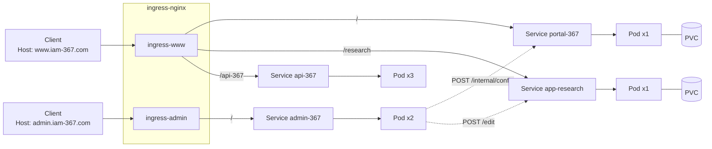

# K8s Ingress Exam (iam-367)

บริการ 4 ตัวบน Kubernetes เข้าถึงผ่าน ingress-nginx ด้วย domain `iam-367.com` (รหัสนักศึกษา 68130367)

| URL | หน้าที่ | Deployment | จำนวน Pod |
|---|---|---|---|
| `www.iam-367.com/` | แสดงรูป ชื่อ และ id ของนักศึกษา | `portal-367` | 1 (ข้อมูลเก็บใน PVC) |
| `www.iam-367.com/research` | แสดงสรุปงานวิจัย | `app-research` | 1 (ข้อมูลเก็บใน PVC) |
| `www.iam-367.com/api-367/<ข้อความ>` | แสดงข้อความตัวใหญ่กลางจอ | `api-367` | 3 |
| `admin.iam-367.com` | หน้าปุ่มเลือกแก้ไขข้อมูลของ portal และ research | `admin-367` | 2 |



หน้า admin เป็นตัวส่งข้อมูลที่แก้ไปให้ `portal-367` และ `app-research` ผ่าน Service ภายใน cluster (ไม่ผ่าน ingress) แต่ละตัวเขียนลง PVC ของตัวเอง ส่วนเส้นทาง `/internal/*` ของสองตัวนี้ปฏิเสธ (403) เมื่อมาจาก ingress

## สรุปสั้น

ถ้ามี cluster ที่มี ingress-nginx อยู่แล้ว (ตัวอย่างที่ทดสอบ: minikube 3 node) ใช้ชุดคำสั่งนี้ก็ deploy และทดสอบเสร็จ ใช้ได้ทั้ง macOS, Linux และ Windows

```bash
git clone https://github.com/68130367/k8s-ingress-exam.git
cd k8s-ingress-exam
kubectl get ingressclass nginx
kubectl apply -k .
kubectl logs -f job/ingress-check --pod-running-timeout=180s
```

คำสั่งที่สามต้องขึ้นแถว `nginx` ถ้าไม่ขึ้นให้ทำข้อ 1 ก่อน คำสั่งสุดท้ายแสดงผลทดสอบ 12 ข้อ ผลที่ถูกต้องคือบรรทัดสุดท้ายเป็น `---- pass=12 fail=0`

> ถ้า cluster ไม่มี default StorageClass (ตรวจด้วย `kubectl get storageclass`) ให้รัน
> `kubectl apply -f manifests/storage-hostpath.yaml` ก่อน `kubectl apply -k .` ไม่เช่นนั้น PVC จะค้าง Pending
> (`./deploy.sh` ทำขั้นนี้ให้อัตโนมัติ แต่ต้องใช้ bash)

## สิ่งที่ต้องมี

- Kubernetes cluster และ `kubectl` ที่ต่อได้ (`kubectl cluster-info`) โจทย์ต้องการ **3 node** ตรวจด้วย `kubectl get nodes` ต้องเห็น 3 แถวสถานะ `Ready`
- node ต่ออินเทอร์เน็ตได้ (ดึง image `python:3.12-alpine`)
- ingress-nginx (ข้อ 1)

## 1. ติดตั้ง ingress-nginx

**minikube (วิธีที่ใช้ทดสอบ):**

```bash
minikube start --nodes 3 --cpus 2 --memory 2048
minikube addons enable ingress
kubectl get nodes
kubectl get ingressclass nginx
```

**cluster อื่น (kubeadm, VM, Docker Desktop ฯลฯ):** ติดตั้งตามเอกสารทางการของ ingress-nginx ที่ https://kubernetes.github.io/ingress-nginx/deploy/ แล้วตรวจว่า `kubectl get ingressclass nginx` มีแถว `nginx` และ Service ชื่อ `ingress-nginx-controller` อยู่ใน namespace `ingress-nginx` (check Job ใช้ชื่อนี้ ถ้าติดตั้งชื่ออื่นให้เพิ่ม env `INGRESS_HOST` (ชื่อ Service) ใน `manifests/50-check-job.yaml`)

## 2. Deploy

```bash
kubectl apply -k .
kubectl get pods -o wide
```

หรือใช้ `./deploy.sh` (bash) ซึ่งตรวจ cluster, ingress class, StorageClass แล้ว apply และรอ pod พร้อม

ค่าชื่อและรหัสนักศึกษาอยู่ที่ `config.env` ส่วนรูปอยู่ที่ `portal-367/photo.jpg` และสรุปงานวิจัยตั้งต้นอยู่ที่ `app-research/research.seed.md`

## 3. เปิดด้วยเบราว์เซอร์

ingress ใช้ชื่อ host ในการแยกบริการ จึงต้องให้เครื่องรู้จัก `www.iam-367.com` และ `admin.iam-367.com` โดยเพิ่ม 1 บรรทัดในไฟล์ hosts

| ระบบ | ไฟล์ hosts |
|---|---|
| Linux, macOS | `/etc/hosts` (ต้องใช้ `sudo`) |
| Windows | `C:\Windows\System32\drivers\etc\hosts` (เปิดด้วย Administrator) |

**minikube บน Docker driver (macOS/Windows/Linux):** เปิด port-forward ค้างไว้ในหน้าต่างหนึ่ง

```bash
kubectl port-forward -n ingress-nginx svc/ingress-nginx-controller 8080:80
```

เพิ่มบรรทัดนี้ใน hosts

```
127.0.0.1 www.iam-367.com admin.iam-367.com
```

แล้วเปิด `http://www.iam-367.com:8080/`, `http://www.iam-367.com:8080/research`, `http://www.iam-367.com:8080/api-367/สวัสดี` และ `http://admin.iam-367.com:8080/`

**cluster บน VM หรือเครื่องจริง:** ใช้ IP ของ node กับ NodePort ของ ingress-nginx

```bash
kubectl get svc -n ingress-nginx ingress-nginx-controller   # ดู NodePort ของพอร์ต 80
kubectl get nodes -o wide                                   # ดู INTERNAL-IP
```

เพิ่มบรรทัด `<IP ของ node> www.iam-367.com admin.iam-367.com` ใน hosts แล้วเปิดด้วย `:<NodePort>` ต่อท้าย

## 4. ทดสอบ

**ทดสอบใน cluster (ไม่ต้องแก้ hosts):**

```bash
kubectl logs job/ingress-check
```

Job รันใน cluster ยิง request เข้า ingress ด้วย Host header ของแต่ละบริการ ตรวจ 12 ข้อ รวมถึงว่า `/internal/config` ไม่เปิดจากภายนอก

รันซ้ำ: `kubectl delete job ingress-check` แล้ว `kubectl apply -k .`

**ตรวจ pod กระจายหลาย node:**

```bash
kubectl get pods -o wide
```

**ตรวจการแก้ข้อมูลผ่าน admin:** เปิด `admin.iam-367.com` กด "แก้ portal" หรือ "แก้ research" บันทึก แล้วเปิดหน้า `www.iam-367.com/` และ `/research` ดูว่าเปลี่ยนตาม

## 5. ล้างทั้งหมด

```bash
kubectl delete -k .
# หรือ ./teardown.sh  (ลบ PV ที่ deploy.sh สร้างให้ด้วย)
```

## โครงสร้างไฟล์

```
.
├── README.md
├── config.env                 ชื่อและรหัสนักศึกษา
├── kustomization.yaml         รวม manifest และสร้าง ConfigMap จากโค้ดแอป
├── deploy.sh / teardown.sh    สคริปต์ deploy / ล้าง (bash)
├── portal-367/                app.py + photo.jpg
├── app-research/              app.py + research.seed.md
├── api-367/                   app.py
├── admin-367/                 app.py
├── manifests/
│   ├── 10-portal-367.yaml     PVC + Deployment + Service
│   ├── 20-app-research.yaml   PVC + Deployment + Service
│   ├── 30-api-367.yaml        Deployment (3 replicas) + Service
│   ├── 35-admin-367.yaml      Deployment (2 replicas) + Service
│   ├── 40-ingress.yaml        ingress-www, ingress-admin
│   ├── 50-check-job.yaml      Job ทดสอบใน cluster
│   └── storage-hostpath.yaml  PV สำรอง (ใช้เมื่อไม่มี default StorageClass)
├── tests/                     check_in_cluster.py (ใช้ใน Job), check.sh (ยิงจากเครื่อง)
└── evidence/                  ผลคำสั่งและภาพหน้าจอจากการรันจริง
```

โค้ดแอปเป็น Python (ไลบรารีมาตรฐานเท่านั้น) รันใน image `python:3.12-alpine` โดย mount โค้ดจาก ConfigMap จึงไม่ต้อง build image
